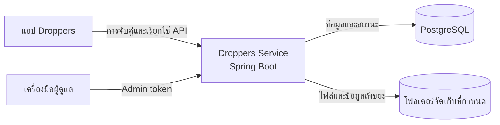

<div align="center">

# Droppers Service

### จัดการไฟล์บนพื้นที่จัดเก็บที่คุณควบคุมเอง

บริการ API สำหรับระบบจัดการไฟล์แบบติดตั้งและดูแลได้ด้วยตนเอง

จัดการไฟล์และโฟลเดอร์ อัปโหลดไฟล์ขนาดใหญ่ กู้คืนไฟล์จากถังขยะ และเชื่อมต่ออุปกรณ์ที่เชื่อถือได้ โดยเก็บเนื้อหาไฟล์ไว้ในพื้นที่จัดเก็บของคุณเอง


</div>

---

## เกี่ยวกับโครงการ

Droppers Service เป็น backend ที่พัฒนาด้วย Spring Boot สำหรับระบบจัดการไฟล์แบบ local-first โดยเชื่อมการทำงานของระบบไฟล์เข้ากับ PostgreSQL เพื่อจัดเก็บข้อมูลประกอบ เช่น อุปกรณ์ที่เชื่อถือได้และสถานะการอัปโหลด

เนื้อหาไฟล์จะอยู่ในโฟลเดอร์ที่ผู้ดูแลกำหนด ส่วน PostgreSQL ใช้เก็บข้อมูลของแอปพลิเคชันและ metadata ทำให้ผู้ใช้งานเลือกพื้นที่จัดเก็บและดูแลข้อมูลของตนเองได้

## ความสามารถหลัก

| ความสามารถ | รายละเอียด |
| --- | --- |
| จัดการไฟล์และโฟลเดอร์ | เรียกดู อัปโหลด ดาวน์โหลด เปลี่ยนชื่อ ย้าย และสร้างโฟลเดอร์ภายในพื้นที่จัดเก็บที่กำหนด |
| อัปโหลดไฟล์ขนาดใหญ่ | สร้างรายการอัปโหลด ส่งเนื้อหาไฟล์ ติดตามสถานะ และล้างรายการที่ค้างเกินกำหนด |
| ถังขยะ | ย้ายไฟล์ไปถังขยะ เรียกดู กู้คืน หรือลบออกอย่างถาวร |
| เชื่อมต่ออุปกรณ์ | จับคู่อุปกรณ์และออก token สำหรับเรียกใช้ API ที่ต้องยืนยันตัวตน |
| จัดการระบบ | อนุมัติการจับคู่ จัดการอุปกรณ์ และกำหนดพื้นที่จัดเก็บผ่าน API สำหรับผู้ดูแล |
| รองรับ Docker | สร้าง image แบบหลายขั้นตอน ใช้ Java 21 Alpine และรันแอปด้วยผู้ใช้ที่ไม่มีสิทธิ์ root |
| จัดการ schema | ใช้ Liquibase สร้างและปรับปรุง schema ของ PostgreSQL เมื่อเริ่มระบบ |

## ภาพรวมสถาปัตยกรรม



API แบ่งออกเป็น 3 กลุ่ม:

| กลุ่ม API | เส้นทาง | การเข้าถึง |
| --- | --- | --- |
| Public | `/public/api/v1/**` | ตรวจสอบสถานะระบบ ข้อมูลพื้นที่จัดเก็บ และขั้นตอนจับคู่อุปกรณ์ |
| Device | `/device/api/v1/**` | ต้องใช้ device token สำหรับจัดการไฟล์ โฟลเดอร์ การอัปโหลด ถังขยะ และข้อมูลพื้นที่จัดเก็บบนอุปกรณ์ |
| Back office | `/back-office/api/v1/**` | ต้องใช้ admin token สำหรับจัดการอุปกรณ์ อนุมัติการจับคู่ และกำหนดพื้นที่จัดเก็บ |

## เริ่มใช้งานด้วย Docker

### สร้าง Docker image

สั่งจากโฟลเดอร์หลักของ repository:

```bash
docker build -t droppers-service:latest .
```

ขั้นตอน build จะรัน Gradle `build` task จากนั้นนำ executable JAR ไปใส่ใน runtime image ที่ใช้ Java 21 Alpine

### เริ่ม service

ตัวอย่างนี้เชื่อมต่อกับ PostgreSQL ที่ทำงานอยู่บนเครื่อง host โดยฐานข้อมูลต้องอนุญาตให้ container เชื่อมต่อได้

```bash
mkdir -p "$HOME/Droppers"

docker run -d --name droppers-service \
  --restart unless-stopped \
  -p 8765:8765 \
  --add-host=host.docker.internal:host-gateway \
  -e DATABASE_HOST=host.docker.internal \
  -e DATABASE_PORT=5432 \
  -e DATABASE_NAME=droppers \
  -e DATABASE_USER=droppers \
  -e DATABASE_PASSWORD='เปลี่ยนเป็นรหัสผ่านฐานข้อมูล' \
  -e DROPPERS_ALLOWED_HOSTS=localhost,127.0.0.1 \
  -e DROPPERS_ADMIN_TOKEN='เปลี่ยนเป็น secret แบบสุ่มที่คาดเดายาก' \
  -v "$HOME/Droppers:/data" \
  droppers-service:latest
```

แอปจะรับการเชื่อมต่อที่พอร์ต `8765` ภายใน container และทำงานด้วย UID `10001` โฟลเดอร์ที่ mount เข้ามาต้องเขียนได้โดยผู้ใช้นี้ ตัวอย่างบน Linux:

```bash
sudo chown -R 10001:10001 "$HOME/Droppers"
```

หาก PostgreSQL ทำงานใน container อื่น ให้นำทั้งสอง container เข้า Docker network เดียวกัน และกำหนด `DATABASE_HOST` เป็นชื่อ container หรือชื่อ service ของ PostgreSQL อย่ากำหนดเป็น `localhost` เพราะ `localhost` ภายใน container จะหมายถึง container นั้นเอง

### กำหนดพื้นที่จัดเก็บไฟล์

โฟลเดอร์ที่ mount ไว้จะอยู่ที่ `/data` ภายใน container กำหนดให้เป็น storage root ผ่าน admin API:

```bash
curl -X PUT http://127.0.0.1:8765/back-office/api/v1/storage/root \
  -H 'Content-Type: application/json' \
  -H 'X-Droppers-Admin-Token: เปลี่ยนเป็น secret แบบสุ่มที่คาดเดายาก' \
  -d '{"path":"/data"}'
```

ตรวจสอบสถานะ service:

```bash
curl http://127.0.0.1:8765/public/api/v1/health
```

คำสั่งดู log และหยุดหรือเริ่ม container:

```bash
docker logs -f droppers-service
docker stop droppers-service
docker start droppers-service
```

สำหรับระบบที่เปิดให้เข้าถึงจากภายนอก ควรเก็บ secret ผ่านระบบจัดการ secret ของแพลตฟอร์มที่ใช้ deploy และใช้พื้นที่จัดเก็บแบบ persistent ทั้งสำหรับ PostgreSQL และไฟล์ หากวาง service ไว้หลัง reverse proxy ให้ตั้งค่า TLS, allowed hosts และ trusted proxies ให้ตรงกับสภาพแวดล้อมจริง

## เริ่มใช้งานในเครื่อง

### สิ่งที่ต้องเตรียม

- Java 21
- PostgreSQL
- โฟลเดอร์สำหรับจัดเก็บไฟล์ที่อ่านและเขียนได้

ใน repository มี Gradle wrapper ให้แล้ว ไม่จำเป็นต้องติดตั้ง Gradle แยก

สร้าง role และฐานข้อมูลสำหรับพัฒนา จากนั้นเริ่มแอป:

```bash
psql -U postgres -c "CREATE ROLE droppers LOGIN PASSWORD 'droppers';"
createdb -U postgres -O droppers droppers
./gradlew bootRun
```

ค่าเริ่มต้น แอปรับการเชื่อมต่อที่ `http://127.0.0.1:8765` และ Liquibase จะสร้างหรือปรับปรุง schema เมื่อเริ่มแอป

## การตั้งค่า

ตั้งค่าผ่าน environment variables:

| ตัวแปร | ค่าเริ่มต้น | รายละเอียด |
| --- | --- | --- |
| `DROPPERS_BIND_ADDRESS` | `127.0.0.1` (Docker ใช้ `0.0.0.0`) | IP address ที่แอปใช้รับการเชื่อมต่อ |
| `DATABASE_HOST` | `localhost` | hostname หรือชื่อ service ของ PostgreSQL |
| `DATABASE_PORT` | `5432` | พอร์ต PostgreSQL |
| `DATABASE_NAME` | `droppers` | ชื่อฐานข้อมูล ต้องสร้างฐานข้อมูลไว้ก่อนเริ่มแอป |
| `DATABASE_USER` | `droppers` | ผู้ใช้ฐานข้อมูล |
| `DATABASE_PASSWORD` | `droppers` | รหัสผ่านฐานข้อมูล ควรเปลี่ยนเมื่อใช้นอกเครื่องพัฒนา |
| `DROPPERS_ALLOWED_HOSTS` | `localhost,127.0.0.1,::1` | รายการค่า `Host` ที่อนุญาต คั่นด้วย comma |
| `DROPPERS_RATE_LIMIT_PER_MINUTE` | `120` | จำนวน request สูงสุดต่อ client ต่อนาทีในแต่ละ instance |
| `DROPPERS_REQUIRE_TLS_FOR_LAN` | `true` | บังคับใช้ TLS เมื่อรับ request จาก LAN |
| `DROPPERS_TLS_ENABLED` | `false` | เปิดใช้ TLS ของ Spring Boot |
| `DROPPERS_TLS_KEY_STORE` | ไม่กำหนด | path ของ TLS keystore |
| `DROPPERS_TLS_KEY_STORE_PASSWORD` | ไม่กำหนด | รหัสผ่านของ TLS keystore |
| `DROPPERS_TLS_KEY_ALIAS` | ไม่กำหนด | alias ของ TLS key |
| `DROPPERS_DEVICE_SESSION_TTL_DAYS` | `30` | อายุของ device session เป็นวัน |
| `DROPPERS_DEVICE_PORTAL_URL` | ว่าง | URL ของ portal ที่ใช้สร้างลิงก์และ QR code สำหรับจับคู่อุปกรณ์ |
| `DROPPERS_ADMIN_TOKEN` | ว่าง | secret สำหรับเรียกใช้ back-office API ควรกำหนดก่อน deploy |
| `DROPPERS_TRUSTED_PROXIES` | ว่าง | IP ของ proxy ที่อนุญาตให้ส่ง forwarded headers คั่นด้วย comma |
| `DROPPERS_MAX_UPLOAD_BYTES` | `1073741824` | ขนาดอัปโหลดสูงสุดเป็น byte (1 GiB) |
| `DROPPERS_UPLOAD_STAGING_TTL_HOURS` | `24` | ระยะเวลาก่อนล้างรายการอัปโหลดที่ไม่มีการใช้งาน |
| `DROPPERS_UPLOAD_CLEANUP_INTERVAL_MILLIS` | `3600000` | ความถี่ในการตรวจล้างรายการอัปโหลด (1 ชั่วโมง) |

เมื่อวางหลัง reverse proxy ให้ใส่เฉพาะ IP ของ proxy ที่เชื่อถือได้ใน `DROPPERS_TRUSTED_PROXIES` และตั้ง proxy ให้ลบ `X-Forwarded-*` ที่ client ส่งเข้ามาก่อน แล้วใส่ค่าของ proxy เอง

## ขั้นตอนอัปโหลดไฟล์

เริ่มจากสร้าง upload transfer ซึ่ง response จะมี ID สำหรับส่งเนื้อหาไฟล์:

```text
POST /device/api/v1/transfers/uploads
        │
        └── response มี transfer ID
                │
                ▼
PUT /device/api/v1/transfers/uploads/{id}/content
```

ปลายทางรับข้อมูลด้วย content type `application/octet-stream` และขนาดสูงสุดกำหนดได้ผ่าน `DROPPERS_MAX_UPLOAD_BYTES`

## การพัฒนาและตรวจสอบโค้ด

รันทดสอบและตรวจรูปแบบโค้ด:

```bash
./gradlew test
./gradlew spotlessCheck
```

จัดรูปแบบโค้ดด้วย formatter ของโครงการ:

```bash
./gradlew spotlessApply
```

## สำรองและกู้คืนข้อมูล

ข้อมูลของ Droppers แยกเป็นสองส่วน ได้แก่ metadata ใน PostgreSQL และเนื้อหาไฟล์ใน storage root ควรสำรองข้อมูลทั้งสองส่วนในช่วงเวลาเดียวกัน โดยหยุด service ก่อน เพื่อให้ข้อมูลฐานข้อมูลและไฟล์สอดคล้องกัน

```bash
pg_dump -Fc -h "$DATABASE_HOST" -p "${DATABASE_PORT:-5432}" \
  -U "$DATABASE_USER" "$DATABASE_NAME" > /backup/droppers-$(date +%F).dump

rsync -a -- "/path/to/configured/storage-root/" \
  "/backup/droppers-files-$(date +%F)/"
```

กู้คืนไฟล์ไปยังตำแหน่งที่ต้องการ แล้วกู้คืนฐานข้อมูล:

```bash
pg_restore --clean --if-exists -d "$DATABASE_NAME" \
  /backup/droppers-YYYY-MM-DD.dump
```

หลังจากเริ่ม service ให้ตรวจ `GET /public/api/v1/health` ควรเก็บ backup มากกว่าหนึ่งชุดและทดลองกู้คืนเป็นระยะ

## โครงสร้างโครงการ

```text
src/main/java/com/ravzeno/droppers_service/
├── commons/             configuration, filters, utilities และ exceptions ที่ใช้ร่วมกัน
├── domains/             ความสามารถด้าน device, file, pairing, storage, transfer และ trash
│   ├── dto/              request และ response ของ API
│   ├── model/            domain models และ persistence entities
│   └── query/            ส่วนประกอบสำหรับ custom database queries
└── scheduler/           งานเบื้องหลัง เช่น การล้าง upload ที่หมดอายุ

src/main/resources/
└── db/                   Liquibase changelog และประวัติ schema

src/test/java/            unit tests และ integration-style tests
```

## License

ขณะนี้ repository ยังไม่มีไฟล์ license หากต้องการนำโค้ดไปใช้หรือเผยแพร่ต่อ กรุณาตรวจสอบเงื่อนไขกับเจ้าของโครงการก่อน
